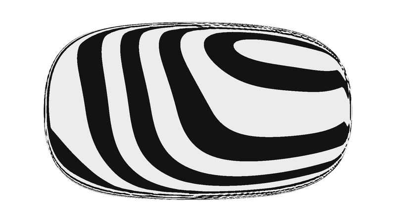
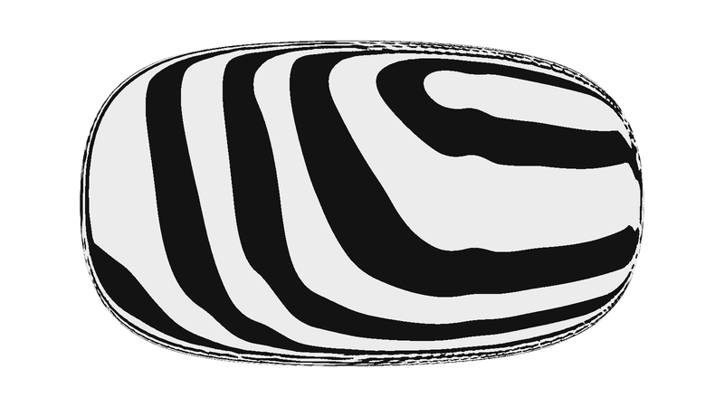

# Fairness checks

A shaded view hides most surface flaws. Use checks that amplify them, on a host preview,
before the native import.

## Guide report

For every guide list the number of control values, the largest deviation from its keys,
the inflections and the curvature extrema (`Guide.fairness()`). Review the list as a
table. Guides with many control values and small deviations are the first suspects.

## Plane sections

Cut the primary surfaces and the blended result with planes and draw their zero
contours together, one colour per surface and a heavier line for the result:

```python
a, b, vals = sf.section_grid(field, axis=0, value=0.8, lo=(0.0, 0.1), hi=(1.1, 1.8), n=700)
plt.contour(a, b, vals, levels=[0.0])
```

Use a dozen stations per axis, including stations between the fitting keys and through
every seam and corner. Sections show what each surface does where it is not visible,
which surface owns each stretch of the result, and where surfaces cross at a poor angle.

## Curvature against arc length

`scripts/section_curvature.py` traces a section outline, resamples it at a fixed arc
length step and reports the turn per metre:

```text
python scripts/section_curvature.py body.stl --scale 0.001 --axis x --at 0.3 0.8 1.5 --step 0.004
```

- A kink is a spike. A ripple is a run of extra sign changes or extra peaks.
- Compare the count of peaks and sign changes with what the design needs.
- Keep the step several times the mesh or grid cell. Below that the report measures the
  sampling. Repeat at twice the density before reading small differences.
- Prefer sections taken from the field over sections of a mesh.

Recorded use: plan cuts and transverse cuts through a lip root showed bounded curvature
after the repair, where the earlier surface had a spike at a blunt root.

## Zebra stripes

`scripts/zebra.py` colours a mesh by the angle between the surface normal and a fixed
direction, in alternating bands, for two directions. Pass normals taken from the field
(`field_normals`) when the mesh comes from the host evaluator, so the stripes show the
surface and not the mesh facets:

```text
python scripts/zebra.py body.stl --scale 0.001 --views front34 rear34 side top
```

Read the stripes like reflections of parallel light bars:

| Stripe behaviour | Meaning |
|---|---|
| Stripe breaks or steps sideways | position or tangent break |
| Stripe has a corner | curvature break |
| Stripe wiggles, pinches or forms islands on a broad face | ripple or unwanted inflection |
| Stripes even and slowly varying, bending once through a seam | fair surface, clean blend |
| Tight bundle of stripes along a line | a crease or a tight blend. Correct if it is a designed feature line |

The bundled example (`scripts/example_body.py zebra`) builds one body twice from the same
station heights, which carry about a millimetre of scatter. The two bodies look the same
in a shaded view:

| Crown guide with 7 control values and a penalty | Crown guide with 24 control values through the keys |
|---|---|
|  |  |

Practical points:

- Look from several directions. A ripple that runs along the view direction is hidden.
- Use two stripe directions. One direction is blind to curvature about its own axis.
- The mesh must be finer than the flaw. A host mesh at 8 mm cells showed the body-scale
  ripples in the recorded case. Stair-stepped stripe edges at mesh scale are meshing.
- Lower the stripe count for small or tightly curved parts.
- Check the envelope before cutting details, and the painted shell after.

## Reference overlay

Project the silhouette edges of the preview mesh onto each calibrated reference view and
compare. Do this after the fairness checks, and report the deviations that fairness
cost. A silhouette match says nothing about the surface between the silhouettes.

## Symptom, cause, repair

| Symptom | Usual cause | Repair |
|---|---|---|
| Stripes ripple along a face | Guide fitted through many keys | Refit with fewer control values and a penalty, or design the curvature |
| Drips or waves on a face lofted from a plan outline | Traced outline with oscillating curvature | Replace the outline with a designed curvature history |
| Round dimples near the end of a loft | Control rows collapse or are clamped against each other | Let rows converge smoothly. End the face with a trim |
| Pinched ridge up a pillar or along a shoulder | Surfaces meet at a shallow or reversing angle | Split the face into separate primary surfaces that cross steadily |
| Crease on the centreline | Half section not perpendicular to the mirror plane, or a term linear in the absolute coordinate | Equal height for the first two control points. Use the square of the coordinate |
| Hairline groove along a crown line | Numerical floor in a power or square root at zero | Reformulate so the clamp never acts. Factor out the larger term |
| Faceted or noisy normals at a point | Zero gradient: power of zero, square root of zero, coincident control points | Add a small offset under roots. Separate the control points |
| Bump or detached blob at a trim | Trim surface bulges past the body, or a loft tip pokes through | Reshape the trim. Bury the tip inside the neighbour |
| Wavy swept edge | Edge built from several curves or from stations with scatter | One guide for the edge. Calibrate it to a law |
| Section looks bumpy between stations | Too many stations, each adjusted by hand | Reduce stations, refit, check between them |
| Seam shows though both surfaces are fair | Blend width too tight for the crossing angle, or blend order | Choose the width for that seam. Reorder nested blends |
| Flaw only in the native mesh | Mesh tolerance, sharp cut on a thin layer, clipped bounding box | Blend the cut edge, enlarge the box, tighten the tolerance |

## What the checks do not establish

Sampled sections and stripe images show the stations and views that were sampled. They
do not prove continuity of the whole surface, a curvature tolerance, or an automotive
Class A sign-off. State the stations, views, mesh size and step used, and what was left
unchecked.
